 

 

  

 

## Projects

<table>
<tr>
<td width="50%" valign="top">

Early development. Discovery and the LLM gateway work; the rest is planned. 
<a href="https://github.com/dheerukarra/jobai">Repository</a>

</td>
<td width="50%" valign="top">

Twelve interactive three.js scenes, deployed from GitHub to AWS Amplify. 
<a href="https://github.com/dheerukarra/dheeraj-aws-portfolio">Repository</a> · <a href="https://main.d20iokpmvk0ua7.amplifyapp.com/">Live site</a>

</td>
</tr>
<tr>
<td width="50%" valign="top">

Paper trading only. No real money is ever placed. 
<a href="https://github.com/dheerukarra/polybot">Repository</a>

</td>
<td width="50%" valign="top">

Code runs client-side via Pyodide, with auto-graded tests, XP and badges. 
<a href="https://github.com/dheerukarra/python-learning-platform">Repository</a> · <a href="https://python-learning-platform.netlify.app">Live demo</a>

</td>
</tr>
</table>

 

 

The loss surface and the skills embedding are toy illustrations, not real model output.

